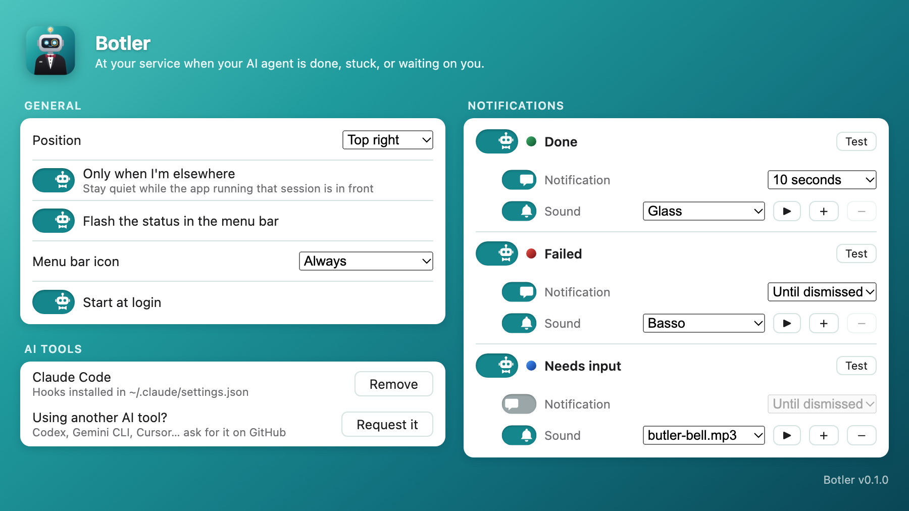

# Botler

A macOS menu-bar butler that tells you when your AI coding agent is done, hit an error, or needs your input, so you can look away while it works. It supports Claude Code today; other tools plug in through adapters (see [Supported tools](#supported-tools)).

Website: https://thewolfnl.github.io/botler/ (source in `docs/`, deployed by `.github/workflows/pages.yml`).



## How it works

Claude Code [hooks](https://code.claude.com/docs/en/hooks) run `botler hook claude` with the event as JSON on stdin:

| Hook | Notification | Colour | Default |
|---|---|---|---|
| `Stop` | Claude is done | green | hides after 10 s, `Glass` |
| `StopFailure` | Claude hit an error (rate limit, API error) | red | stays until dismissed, `Basso` |
| `Notification` | Claude needs you (permission prompt, idle, question) | blue | stays until dismissed, `Ping` |

`Notification` events of type `auth_success` are ignored. The CLI turns the payload into a short message (the last assistant message, the error details or the notification text), names the project after the session's `cwd`, and walks its parent processes to the outermost app bundle (Terminal, iTerm, Ghostty, VS Code, …) hosting the session. It hands that to the running app over `~/Library/Application Support/botler/notify.sock` and always exits 0, so a hook never shows an error inside the AI tool. When the app isn't running, the CLI starts it in the background (`open -g`) and covers that one event with `osascript` + `afplay`.

The app slides a banner onto the screen you are working on (a non-activating panel; top right by default, or top center/left, bottom right/left). Banners stack, newest nearest the corner, and a new event from a session replaces that session's older banner. Clicking a banner brings the host app forward through LaunchServices and dismisses it; the × or Escape only dismisses. Inside tmux or over ssh the host app is the outer terminal, not the exact pane. With **Only when I'm elsewhere** on (the default), nothing is shown while the host app is frontmost.

Each kind can be switched off entirely. While it is on, its notification and its sound are separate toggles, so you can have a sound without a banner or the other way round. You can pick the sound and how long the notification stays (until dismissed, 5, 10, 30 or 60 s). Use **＋** next to a sound picker to add your own audio file (aiff, caf, m4a, mp3 or wav); it is copied to `~/.config/botler/sounds/`. Settings live in `~/.config/botler/config.json`.

The menu bar icon can be shown always, only while notifying (it also shows for 5 s at startup), or never. With the icon hidden, reach Settings by opening the app again (Spotlight/Finder) or running `botler settings`.

## Hooks

```bash
botler hooks install [agent]     # or the Install button under AI tools in Settings
botler hooks status [agent]
botler hooks uninstall [agent]
```

Without an agent ID these act on every supported tool; `claude` is the only one so far.

`install` adds a `Stop`, `StopFailure` and `Notification` hook to `~/.claude/settings.json`, pointing at the resolved app binary (symlinks such as Homebrew's are followed). It keeps the file's key order and every other hook, and replaces hooks left by another copy of Botler. On first launch, if the hooks are missing, the app opens Settings and offers to install them; Homebrew can't ask during `brew install`. The hook command is `[ ! -x "<app binary>" ] || "<app binary>" hook claude`, so it does nothing once the app is removed; run `botler hooks uninstall` first to take it out of `settings.json` too.

Other commands: `botler notify done|failed|input [message]` (send a notification by hand), `botler settings`, `botler --version`.

## Supported tools

| Tool | ID | Hooks file |
|---|---|---|
| Claude Code | `claude` | `~/.claude/settings.json` |

Using Codex, Gemini CLI, Cursor, Copilot CLI or another tool? [Open an issue](https://github.com/TheWolfNL/botler/issues/new?labels=agent-request&title=Support+for+%3Ctool%3E) with a link to its hooks or notification docs and which of done, failed and needs input it can report. The **Request it** button under AI tools in Settings opens the same form.

Each tool is an adapter implementing `agent.Agent` (`internal/agent/agent.go`): it turns one hook payload into an event and installs, removes and checks its hooks. Adding a tool means a package under `internal/agent/<id>/` and an entry in `agents.go`; its hooks call `botler hook <id>`.

## Install

```bash
brew install --cask thewolfnl/tap/botler
```

The cask installs the app, links the CLI as `botler` and clears the quarantine flag (the app is ad-hoc signed, not notarized).

## Build from source

Needs Go, Node 20.19+ or 22.12+ (`.nvmrc` pins 26) and the Wails v3 CLI (`go install github.com/wailsapp/wails/v3/cmd/wails3@latest`).

```bash
wails3 task install
```

This builds the app, installs it to `~/Applications/Botler.app` and links the CLI to `~/.local/bin/botler`. Tests: `go test ./internal/...`; type check the frontend with `npm run typecheck --prefix frontend` (the release workflow runs it before building).

## Notes

- The icon is a robot butler: monocle, tuxedo, burgundy bow tie and a light bulb on its antenna, on a petrol-teal tile. Source SVGs are in `build/icon-src/`; regenerate with `inkscape` and `wails3 task common:generate:icons`.

## Releasing

Run `wails3 task release` on an up-to-date, clean `main`. It shows the commits since the last tag, suggests a major/minor/patch bump from Conventional Commit prefixes (`feat:` minor, `!` or `BREAKING CHANGE:` major, otherwise patch; the first release is v0.1.0), adds a section with those commits to `CHANGELOG.md`, commits it as `chore: release vX.Y.Z`, tags that commit with a signed `vX.Y.Z` tag and asks before pushing both. `.github/workflows/release.yml` builds a universal (arm64 + amd64) app, ad-hoc signs it and attaches `Botler-X.Y.Z-universal.zip` plus its `.sha256` to a GitHub release, then sends a `bump-cask` dispatch to [TheWolfNL/homebrew-tap](https://github.com/TheWolfNL/homebrew-tap). This needs a `TAP_DISPATCH_TOKEN` secret; without it the step is skipped.

## License

[PolyForm Shield 1.0.0](LICENSE.md). Required Notice: Copyright Tjeerd Ritsma (https://github.com/TheWolfNL)

Not affiliated with Anthropic. Claude is a trademark of Anthropic, PBC.
